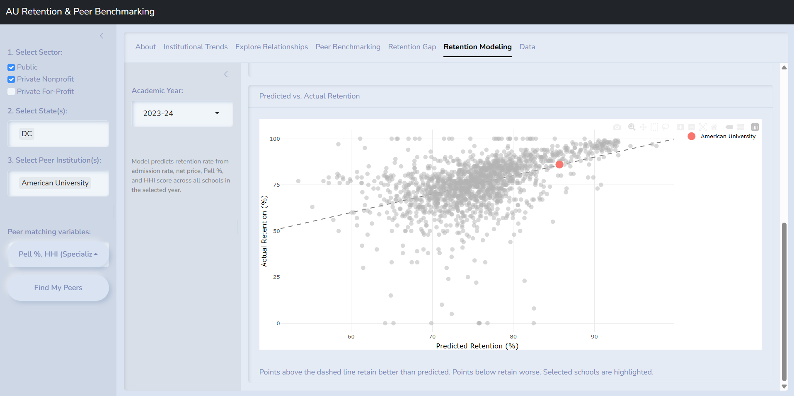

# UGraduate

**Which colleges keep their students, and which schools are actually comparable?**
UGraduate is an interactive R Shiny app for exploring first-year retention across
~3,100 U.S. colleges and universities using five years of federal IPEDS data
(2019-20 through 2023-24).

### [▶ Launch the app](https://evan-blizzard.shinyapps.io/UGraduate/)

<sub>Hosted on a free tier. If it's been asleep, give it 30-60 seconds to wake up.</sub>



------------------------------------------------------------------------

## What it does

Institutions usually benchmark against a hand-picked list of "peer" schools and
eyeball retention numbers in isolation. UGraduate replaces both with something
data-driven:

-   **Find peers objectively.** Pick a school and the variables that matter to you
    (admit rate, net price, Pell share, program specialization). The app ranks the
    10 most similar institutions by z-score-normalized Euclidean distance.
-   **See if a school beats expectations.** A multiple regression predicts each
    school's retention from its admissions, pricing, and student profile. Schools
    above the line retain better than their profile predicts, and schools below
    retain worse.
-   **Explore freely.** Track any metric over time, plot any two variables against
    each other, and download the filtered data.

## Key findings (2023-24, n = 1,636 institutions)

-   Admit rate, net price, Pell share, and program specialization together explain
    about **23% of the variation** in retention (R² = 0.23; 0.33 in 2019-20). Most
    of what drives retention isn't captured by these institutional features.
-   **Pell share is the strongest predictor.** Holding the other variables constant,
    a school with a 10-point-higher Pell share retains about **3 percentage points**
    fewer students.
-   **More selective schools retain more.** Each 10-point drop in admit rate goes
    with about 1.6 points higher retention.

These are cross-sectional associations, not causal effects. See
[Interpretation](#interpretation--limitations).

## App tour

| Tab | What you can do |
|------------------------------|------------------------------------------|
| **Institutional Trends** | Line charts of any metric over time for selected schools |
| **Explore Relationships** | Scatter any two variables, with selected schools highlighted and an optional trend line |
| **Peer Benchmarking** | Ranked list of the most similar institutions by your chosen variables |
| **Retention Modeling** | Coefficient plot, predicted vs. actual retention, and residual / Q-Q diagnostics |
| **Data** | Filterable table with CSV download |

<details>
<summary>Variables</summary>

| Variable | Description |
|------------------------------|------------------------------------------|
| `ret_pres` | First-year retention rate (%) |
| `pell_pct` | Share of undergraduates receiving Pell Grants (%) |
| `hhi_score` | Herfindahl-Hirschman Index of degrees awarded across programs (0-1; higher = more specialized) |
| `admit_rate` | Admissions ÷ applicants (%) |
| `net_price_avg` | Average net price after grant aid ($) |
| `net_price_avg_pell` | Average net price for Pell recipients ($) |
| `control` | Sector: 1 = public, 2 = private nonprofit, 3 = private for-profit |

</details>

## Methods

**Data.** Institution-level files from the
[Integrated Postsecondary Education Data System (IPEDS)](https://nces.ed.gov/ipeds/),
NCES, for academic years 2019-20 to 2023-24. Five annual IPEDS databases were
joined on `unitid` and combined into a single panel (`data/master_data.csv`,
14,408 institution-years). See [`data/data_ingestion.qmd`](data/data_ingestion.qmd).

**Peer matching.** Selected variables are z-score standardized, and peers are
ranked by Euclidean distance to the target school within the chosen year.

**Retention model.** OLS regression, fit separately for each year:

```
retention ~ admit_rate + net_price_avg + pell_pct + hhi_score
```

Diagnostics (residuals vs. fitted, normal Q-Q) are built into the app.

## Run it locally

Requires R ≥ 4.3.0.

```bash
git clone https://github.com/evanblizzard/ugraduate.git
cd ugraduate
```

```r
install.packages("renv")
renv::restore()   # installs the exact package versions used
shiny::runApp()
```

The processed data ships with the repo, so no download is needed. To rebuild it
from scratch, download the IPEDS Access databases for 2019-20 to 2023-24 into
`data_raw/` and render `data/data_ingestion.qmd`.

**Built with:** shiny, bslib, plotly, DT, tidyverse, broom, shinyWidgets, renv

## Interpretation & limitations

-   **Association, not causation.** The model describes cross-sectional patterns.
    It shouldn't be used to judge a specific institution's policies.
-   **Pell gaps reflect structural inequity.** Lower retention at high-Pell schools
    reflects the resources and circumstances of the students those schools serve.
    It isn't evidence of institutional failure.
-   **HHI is descriptive.** A high specialization score isn't a quality rating.
-   **Small schools are noisy.** Very small institutions can report extreme values
    (e.g., 100% retention from a handful of students). Interpret them with care.
-   **Privacy.** IPEDS is aggregated at the institution level. No student-level
    records are used.

## Team

Built for DATA-413/613 at American University, Spring 2026.

| Name | Contributions |
|------------------------|------------------------------------------------|
| **Evan Blizzard** | Data ingestion pipeline, visualizations, UI, statistical modeling |
| Natalie Cope | Code optimization, UI refinement, app polish |
| Adaobi (Myles) Nwatu | Ethics and literature review, debugging |

## License

Code is released under the [MIT License](LICENSE). IPEDS data is a U.S. federal
government product in the public domain.