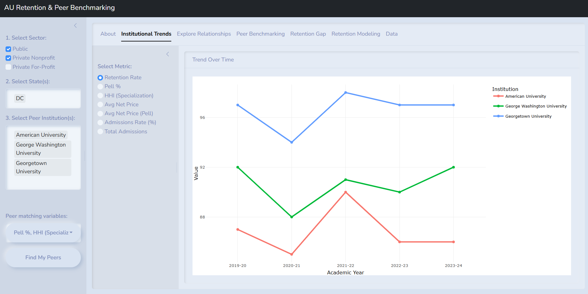
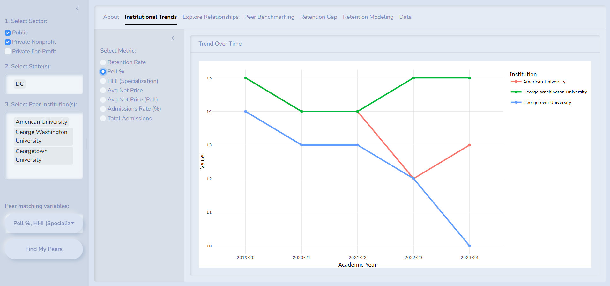
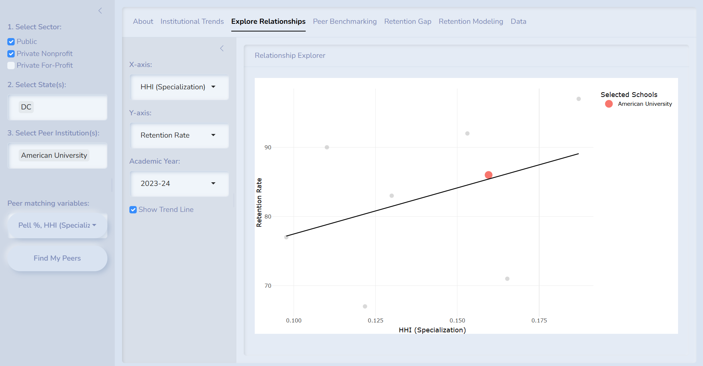
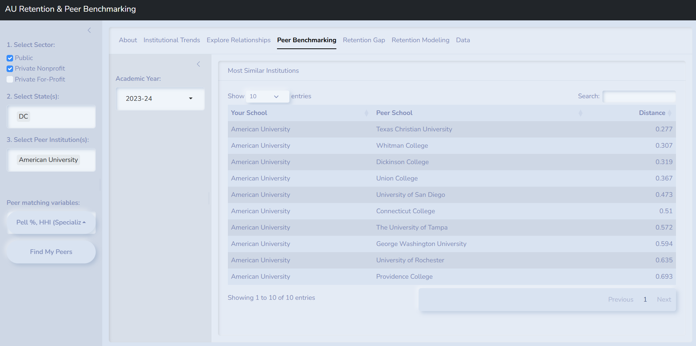
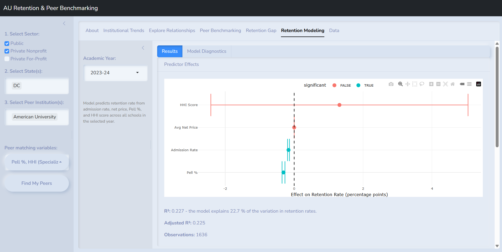
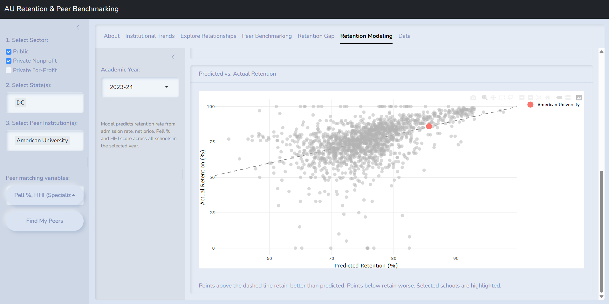

# Use Case

Selecting peer institutions for benchmarking and identifying which institutional characteristics are associated with student retention are two of the most common analytical tasks in institutional research. Both are typically done with small, hand selected comparison sets. Our app, UGradaute addresses this somewhat arbitray means of identifying peers and analyzing retention by giving users a data-driven alternative using the IPEDS dataset of U.S. postsecondary institutions.

The app supports four core tasks: tracking institutional metrics over time, exploring bivariate relationships between institutional characteristics, identifying structurally similar peers via Euclidean distance across user-selected variables, and fitting a multivariate linear model of retention to compare an institution's actual retention against what its admissions, pricing, financial aid, and program profile would predict.

The app is designed for institutional researchers, university administrators, and particularly curious prospective students and families.

------------------------------------------------------------------------

# App Details

## Packages and Versions

This app was built using the packages in @tbl-packages. `{renv}` was used to manage and lock dependencies.

| Package        | Version |
|:---------------|--------:|
| `tidyverse`    |   2.0.0 |
| `shiny`        |  1.12.1 |
| `shinyWidgets` |   0.9.1 |
| `plotly`       |  4.12.0 |
| `bslib`        |  0.10.0 |
| `broom`        |  1.0.11 |
| `DT`           |  0.34.0 |

: Top-level package versions used during development. {#tbl-packages}

## Data Source and Structure

**Data Source.** The app uses publicly available federal data from the Integrated Postsecondary Education Data System (IPEDS), administered by the National Center for Education Statistics (NCES) within the U.S. Department of Education [@ipeds]. IPEDS collects institution-level data annually from every Title IV-eligible postsecondary institution in the U.S., covering enrollment, admissions, completions, retention, financial aid, tuition and fees, and institutional finances. Because Title IV participation is basically a universal precondition for federal student aid, IPEDS is essentially a census of U.S. higher education (rather than a sample) which makes it the appropriate foundation for an institutional benchmarking tool.

**Ingestion.** IPEDS distributes annual data as Microsoft Access database files, one per academic year, downloaded directly from the NCES IPEDS Data Center. Each annual database contains dozens of tables corresponding to different IPEDS surveys (admissions, enrollment, finance, etc.). During preprocessing, the relevant tables from each year were extracted, variables of interest were pulled from each, some variables were created from existing ones, and the per-year frames were merged into a single long-format data frame, `master_data`, with one row per institution per academic year. This dataframe is saved as `data/master_data.RData` and loaded once at app startup.

**Structure.** `master_data` covers 2019-20 through 2023024, with 14,408 rows and 14 columns. There is one row per institution-year, across 3,105 unique institutions. Variables include identifiers (`unitid`, `instnm`, `city`, `stabbr`, `control`, `academic_year`), retention and demographic outcomes (`ret_pres`, `pell_pct`) and cost, selectivity and program structure measures (`applicants`, `admissions`, `admit_rate`, `net_price_avg`, `net_price_avg_pell`, `hhi_score`).

**Restrictions on use.** IPEDS is U.S. federal government data and is in the public domain, so there are no licensing fees, redistribution restrictions, or registration requirements for accessing or using the data. NCES requests that users cite IPEDS as the source in any publications or public-facing materials, per standard NCES citation guidance. Because the data are institution-level aggregates rather than student-level records, there are no FERPA or individual privacy restrictions on use.

------------------------------------------------------------------------

# Exploratory Data Analysis Workflows

## Exploratory Data Analysis I: Institutional Trends

**Scenario.** An institutional research analyst at American University wants to understand how AU's first-year retention rate has shifted over the past several years, and whether nearby nonprofit peers in DC have experienced similar trends. Before running any models or distance calculations, they want to look at the data by plotting one variable at a time across years to identify the pattern.

**Workflow:** The app's global sidebar drives every tab. They select **Private Nonprofit** under *Select Sector*, which dynamically populates the *Select State(s)* dropdown with only the states that have nonprofit institutions in the filtered data. They pick **DC**, then uses the searchable *Select Peer Institution(s)* box to add American University, Georgetown, and George Washington University. This three-step filter (sector to state to school) prevents impossible combinations. They cannot, for example, ask for a public school in a state that has none in the dataset.

From the global sidebar they look over at the *Institutional Trends* tab. Its local sidebar offers one control: a radio-button *Select Metric* list with seven choices (retention rate, Pell %, HHI specialization, two net-price variants, admission rate, and total admissions). They select **Retention Rate**. The main panel renders an interactive Plotly line chart with one line per selected school, colored by institution, across academic years on the x-axis. See @fig-trends-retention.

{#fig-trends-retention}

**Interpreting the output.** The analyst reads three things off the chart. First, *level*. Georgetown sits consistently above AU and GWU, reflecting its more selective admissions profile. Second, *trajectory.* All three schools show a decline going into 2020-21, then an increase in 2021-22, followed by a decline to around pre-pandemic levels for the remaining academic years. Third, *volatility.* The COVID-era cohort shows up immediately with sharp decreases in retention following the onset of the pandemic in the spring semester of the 2019-2020 academic year. She then switches the metric to Pell % to check whether the same schools' Pell-eligible student share moved in tandem with retention, which would suggest the two metrics co-vary. See @fig-trends-pell.

{#fig-trends-pell}

**Responsible Data Science Considerations.** Three things matter:

1.  *Missing Data filtering:* The app drops any institution missing values on the core set of benchmarking variables (ret_pres, pell_pct, hhi_score, net_price_avg, net_price_avg_pell, admit_rate, admissions) before anything is plotted. This keeps every tab consistent, but it also means schools with incomplete IPEDS reporting are invisible in the trend view. The analyst should not interpret a DC comparison set as "all DC nonprofits."
2.  *Autoscaling:* Plotly auto-scales the y-axis to the selected schools, so a three-point range can look as dramatic as a thirty-point range. Differences should always be read against the axis, not the steepness of the line.
3.  *Single-metric framing:* A line chart can show that a metric fell or rose, but not *why*. The analyst should use the Trends tab to generate hypotheses, not for confirmation.

------------------------------------------------------------------------

## Exploratory Data Analysis II: Explore Relationships

**Scenario.** After examining how retention changes over time, the analyst now wants to understand how retention relates to other institutional characteristics. Specifically, they are interested in whether variables such as *program specialization (HHI)*, *admissions rate*, or *financial aid composition* are associated with higher or lower retention across institutions.

**Workflow.** The analyst keeps the same global sidebar selections used in the *Institutional Trends* tab (sector, state, and selected institutions). They then navigate to the *Explore Relationships* tab. In this tab, they select variables for the x- and y-axes (e.g., **HHI Score** vs. **Retention Rate**). The app dynamically filters the dataset based on the sidebar inputs and renders an interactive Plotly scatterplot. If enabled, a regression line is added to show the overall relationship between the selected variables. Selected institutions are **highlighted**, while all other institutions appear in the background for context. See @fig-relationships.

{#fig-relationships}

**Interpreting the output.** The analyst reads three things from the plot. First, *direction.* An upward-sloping pattern suggests a positive association between the variables, while a downward slope suggests the opposite. Second, *strength.* If the points cluster tightly around the regression line, the relationship is more consistent; if they are widely dispersed, the relationship is weaker. Third, *outliers.* Institutions that fall far from the general pattern may indicate unusual characteristics or data quality issues. The highlighted schools allow the analyst to evaluate how their selected institutions compare to the broader national distribution.

**Responsible Data Science Considerations.**

1.  *Correlation vs. causation:* The scatterplot shows **associations**, not causal relationships. A visible trend does not imply that one variable causes changes in another.
2.  *Missing data:* Institutions missing values for either selected variable are excluded from the plot, which may affect the observed relationship.
3.  *Overplotting:* With a large dataset (\~4000 schools), points may overlap, making patterns harder to interpret. Transparency and highlighting help mitigate this.
4.  *Model simplification:* The regression line provides a simplified summary of the relationship and may not capture nonlinear patterns or interactions between variables.

------------------------------------------------------------------------

# Statistical Analysis Workflows

## Statistical Analysis I: Peer Benchmarking

**Scenario.** The same institutional research analyst has now looked at AU's retention trend over time (EDA I) and how retention relates to other variables across DC-area nonprofits (EDA II). Their next question is: *which institutions nationally are most similar to AU on the dimensions she cares about, regardless of geography?* A DC-only list of peers is convenient but technically arbitrary. It may exclude institutions more similar to AU that could be better comparisons on admissions selectivity, pricing, and program mix. They want a data-driven list of peers.

**Workflow.** They reduce their school selection to just AU. They then move to the global sidebar's *Peer matching variables* multi-select picker, which offers the same seven metrics used elsewhere in the app. They select four: **Admit Rate, Avg Net Price, Pell %,** and **HHI Score,** which is their definition of what makes institutions comparable. They click **Find My Peers.**

They then open the *Peer Benchmarking Tab.* Its local sidebar has one control (*Academic Year)* which they set to **2023-24**. The main panel renders a sortable DataTable showing AU's ten closest peers nationally, ranked by Euclidean Distance. See @fig-peer-table.

{#fig-peer-table}

**How the distance calculation works.** The app uses standard z-score normalization before computing distances. Every selected variable is centered at zero and scaled to unit standard deviation across the full pool for the chosen year. This matters because the variables are on wildly different scales: admit rate runs 0-100, net price runs into the tens of thousands of dollars, HHI is bounded 0-1. Without normalization, net price would dominate the distance calculation and the other three variables would be effectively invisible. After scaling, each variable contributes equally to the distance, and the returned distance is unitless. A distance of 0.5 means "close"; a distance of 3 means "far." The numbers are only meaningful relative to each other because they are unitless.

The user can also select multiple schools at once. If they put AU, Georgetown, and GWU in the sidebar selector, the table returns ten peers for each, with the *Your School* column identifying which school each peer row corresponds to.

**Interpreting the output.** The analyst reads the peer list three ways. The first is face validity: do these schools make intuitive sense? If AU's top peers include, say, Boston University and GWU they already considered comparable, the matching variables they chose are doing reasonable work. Second is surprises: any unexpected peer is worth investigating because it either reveals a genuine similarity they had not considered, or it means they should reconsider their variable selection. Thirdly, distance gaps: if the top peer has distance 0.4 and the tenth has distance 2.1, AU has a tight comparison set. If distances are all clustered around 1.5, AU is unusual on this variable combination and no institution is a clean match.

**Responsible Data Science Considerations.**

1.  *The peer set is a user-construct*. It is entirely dependent on the user selected variables. The analyst should report the variable set alongside any peer list.
2.  *Euclidean distance treats all variables as independent and equally weighted, which is rarely true*. For example, admit rate and net price are correlated, so matching on both partially double counts selectivity. A correlation-aware distance would be more defensible, but we used Euclidean as a reasonable attempt within the time frame.
3.  *Missing data exclusion*: the functiond drops any school missing a value on any of the selected matching variables before computing distances, so a school that looks like a great peer on three variables but is missing a fourth never appears in the list.
4.  *Distances aren't probabilities*. "AU's nearest peer has distance 0.4" is not a statement about how likely the relationship is; it's just a sorted ranking.

------------------------------------------------------------------------

## Statistical Analysis II: Retention Modeling

**Scenario.** Peer benchmarking tells the analyst which schools are similar to AU, but not what predicts retention within the peer pool. Their next question is: holding admissions selectivity, net price, Pell share, and academic specialization constant, which of these factors is associated with higher retention, and by how much? They want a fitted model with interpretable coefficients, a view of AU's predicted vs actual retention, and enough diagnostics to determine whether the model is valid.

**Workflow.** They keep their sidebar set as before: AU selected as the main school. They open the *Retention Modeling tab,* whose local sidebar has one control: *Academic Year,* set to **2023-24.** The tab contains two sub-tabs: *Results* and *Model Diagnostics.*

The *Results* sub-tab fits an OLS regression of retention rate on admit rate, average net price, Pell percentage, and HHI score across all institutions in the pool with complete data for the chosen year. It renders two outputs stacked: a coefficient plot with 95% confidence intervals, and a predicted-vs-actual scatter. See @fig-model-results.

::: {#fig-model-results layout-ncol="2"}
{#fig-coef} {#fig-pred-actual} OLS model of first-year retention fit on 2023-24 private nonprofit institutions. Panel (a) shows effect sizes with 95% confidence intervals; the dashed vertical line is zero effect. Panel (b) compares each school's actual retention to the model's prediction; points above the dashed 45-degree line retain better than the model predicts.
:::

**Interpreting the coefficient plot.** The analyst reads of the direction, magnitude, and precision of each predictor. A negative coefficient on admit rate would mean that more selective schools (lower admit rate) have higher retention, holding everything else constant. A positive coefficient on net price would mean higher-priced schools retain better controlling for everything else, which could be plausible if price is interpreted as a proxy for resources per student. The width of the confidence interval matters as much as the point estimate: a predictor whose CI crosses zero is not distinguishable from no effect in this sample, and the plot colors it accordingly.

The card below the coefficient plot displays the model's $R^2$ and adjusted $R^2$, phrased in plain language ("the model explains X% of the variation in retention rates"). This helps with interpretation: if $R^2$ is 0.25, four predictors explain a quarter of the variation across institutions and the remaining three-quarters is driven by factors the model does not include.

**Interpreting predicted vs actual.** The scatter places AU in context. If AU's point sits on the 45-degree line, its retention rate is exactly what the model predicts given its inputs (AU is neither over nor underperforming on retention relative to other institutions). If AU sits meaningfully above the line, it reatins students better than its admissions, price, Pell, and HHI profile predicts. Below the line is the reverse. The colored vs gray layering lets the analyst see AU's retention and its position in the residual distribution at the same time.

**The Diagnostics sub-tab.** The analyst clicks over to *Model Diagnostics*, which renders a residuals-vs-fitted plot and a normal Q-Q plot side by side. These check the assumptions behind the coefficient plot's confident intervals. See @fig-model-diag

{#fig-model-diag}

**Responsible data science considerations.**

1.  *The model is not causal.* It describes which institutional characteristics are correlated with retention in a given year, not what would happen if a school changed one of them. For example, "Lowering admit rate would raise retention" is not a claim the model supports.
2.  *Four predictors is a small model.* Retention is driven by innumerable factors. A very high $R^2$ would actually be suspicious in a model with this few predictors.
3.  *The comparison pool is all schools nationally.* This means the model is assuming the retention generating process is similar at, say, a 40,000 student research university and a 900 student liberal arts college. This could be rectified if the model was stratified by enrollment size or some other controlling variable, but it is not in our implementation.
4.  *Missing data exclusion.* Any school missing any of the four predictors is dropped entirely, which can bias the sample toward better-reporting institutions.

------------------------------------------------------------------------

## LITERATURE REVIEW REPRISE

UGraduate combines five important area of studies together: federal post-secondary data, unexplored factors that contribute to student retention, understanding the effects that economics play into program specialization and data-driven peer benchmarking to create an interactive, user-friendly research tool.

Each of the analytical modules in the app is grounded in established research practices and the design choices reflect real discussion within the conversation on higher education. Including variable section, normalization strategy, modeling approaches, and responsible-use warnings reflect real considerations from scholars and university administrative bodies.

This sections reviews this literature, and connects it back to the various strategies used in the app's implementation of the previously stated considerations

1.  ETHICAL CONSIDERATIONS:
    1.  *IPEDS Data Infrastructure*
        1.  IPEDS is designed to help NCES meet its mandate to report full and complete statistics on the condition of post-secondary education in the United States, collecting institution-level data in areas including enrollment, admissions, graduate rates and other outcome measures, retention rates, student financial aid, tuition and fees, faculty staff, and finances.
        2.  This mandatory reporting structure is what makes IPEDS the right foundation for a tool targeting institutional comparisons: the data-set is not a convenience sample. The span of coverage means that geographic and sector filters in UGraduate's global sidebar draw on a near-complete census of U.S. post-secondary institutions rather than a selective sample.
        3.  For researchers and institutional administrators using UGraduate, one responsible-use implication flows directly from IPEDS's design. IPEDS data are used at the federal and state level for policy analysis and development and at the institutional level for benchmarking and peer analysis.
            1.  However, the data-set's unit of analysis is the institution, not not the student. Additionally, IPEDS reports aggregate rates, not individual records, meaning that the OLS model in the UGraduate Retention Modeling tab is an ecological regression, and its coefficients should not be interpreted as individual-level causal effects. This has been noted in the app's disclaimer.
    2.  *Missing Data & Sample Bias*
        1.  IPEDS reporting completeness varies across institutions and variables. Institutions with incomplete records on any of the core benchmarking variables are excluded from analysis. This approach is consistent with standard practice in institutional benchmarking, where incomplete reporters are excluded to ensure comparability, but it introduces the risk that the analysis disproportionately reflects better-resourced institutions with more complete reporting capacity.
    3.  *Pell Grant Equity Data Transparency*
    4.  *Program Specialization (The HHI Score)*
2.  TECHNICAL CONSIDERATIONS:
    1.  *Using Regression to Model Student Retention*
    2.  *R-Shiny as a Platform for Institutional Research*
    3.  *Visualization Framing Effects*

------------------------------------------------------------------------

## CONCLUSION

# Contributions

```{block}
#| include: false

LLM USAGE:

Evan: 
1. Utilized Claude Opus 4.6 for help with data ingestion. It aided in writing some of the functions seen in the ingestion.qmd to help me figure out year-by-year changes in the tables that were breaking some of my script. A manual review of my final master_data file ensured no mistakes were made. 

2. Also utilized in helping to build the Euclidean distance function, which I verified worked by checking a small test case of two schools and two variables and manually calculating the distance, which I then checked against function output.

3. Used in formatting some of the UI, such as asking what type of element (navPanel, navset_card_underline, etc.) would be appropriate for whatever element of the app I was working on. Verified through trial and error to see what I thought looked best. 

4. Utilized lightly for help with using Plotly, such as creating text elements that showed certain information when a mouse hovers over a certain part of the plot. Verified manually through running the app and checking.

5. Utilized for creating the Q-Q plot in the Retention Modeling tab, as I had not created one manually before (as in not using the qqnorm() function). I checked that this code worked by comparing the plot against the results of qqnorm with the same data.

Natalie:

Myles:

No LLM was used to generate code that was committed without review or comments explaining the code. All LLM-generated code was tested in the running app before commit.


```

```{block}
#| include: false

GROUP MEMBER CONTRIBUTIONS

Evan: 
  1. Euclidean function and Peer benchmarking tab
  2. Retention Modeling tab including coefficient plot, predicted vs actual scatter,         residuals, and Q-Q diagnostics
  3. Explore Relationships tab
  4. About Tab
  5. renv setup
  6. README
  7. Data Ingestion
  8. Data Table output tab
  9. Institutional Trends tab
  10. Progress Report elements besides Updates of Ethics Review
  11. Project Plan besides Ethics Review and Literature Review
  12. Peer Review
  13. Vignette: EDA I, Statistical Analysis I, Statistical Analysis II, Data Source &            Structure
  
Natalie:


Myles:
```
